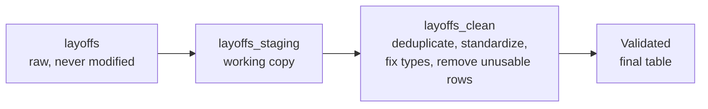

# Layoffs Data Cleaning in MySQL

A data cleaning project on a tech layoffs dataset (2,361 records, March 2020 to March 2023). The raw data is cleaned in SQL using a staging workflow, and every decision is documented and validated.

**Dialect:** MySQL 8.0 | **Tools:** MySQL Server, MySQL Workbench | **Output table:** `layoffs_clean`

---

## Dataset

One row per layoff event, with 9 columns: `company`, `location`, `industry`, `total_laid_off`, `percentage_laid_off`, `date`, `stage`, `country`, `funds_raised_millions`. See [data/README.md](data/README.md) for the source and loading steps.

## Cleaning workflow



| Step | What it does |
|---|---|
| 1. Staging | Copies the raw table so the original is preserved |
| 2. Find duplicates | `ROW_NUMBER()` over every column flags repeated rows |
| 3. Validate duplicates | Reviews flagged rows manually before deleting anything |
| 4. Remove duplicates | Keeps the first occurrence of each event |
| 5. Standardize | Trims spaces, merges spelling variants, fixes country names |
| 6. Missing values | Converts blanks to NULL and fills gaps only where the data supports it |
| 7. Data types | Converts dates and percentages from text to real types |
| 8. Unusable rows | Removes rows with no layoff numbers |
| 9. Validate | Re-checks duplicates, spaces, NULLs, ranges and row counts |

## Cleaning log

| Issue found | Count | Action |
|---|---|---|
| Exact duplicate rows (Casper, Cazoo, Hibob, Wildlife Studios, Yahoo) | 5 | Removed, first occurrence kept |
| Company names with leading or trailing spaces (e.g. `WeWork `) | 11 | Trimmed |
| Industry spelled three ways: `Crypto`, `Crypto Currency`, `CryptoCurrency` | 3 rows | Merged into `Crypto` |
| Country written as `United States.` (trailing period) | 4 | Fixed to `United States` |
| Blank industry values | 3 | Converted to NULL |
| Missing industry (4 rows) | 4 | 3 filled from the same company's other rows (Airbnb, Carvana, Juul); 1 left NULL (Bally's Interactive) |
| `date` stored as text (`3/6/2023`) | all rows | Converted to `DATE` |
| `percentage_laid_off` stored as text | all rows | Converted to `DECIMAL(5,4)` |
| `funds_raised_millions` would be rounded by an `INT` column (45 rows have decimals) | 45 | Stored as `DECIMAL(10,2)` |
| Rows with neither a headcount nor a percentage | 361 | Removed from `layoffs_clean` |

**Row count:** 2,361 raw rows, 2,356 after removing duplicates, 1,995 in the final table.

## Before and after

| Metric | Before | After |
|---|---|---|
| Rows | 2,361 | 1,995 |
| Exact duplicate rows | 5 | 0 |
| Company names with extra spaces | 11 | 0 |
| Distinct industry values | 32 | 30 |
| Blank industry, stage, percentage or date values | 3 | 0 |
| Rows with no headcount and no percentage | 362 | 0 |
| `date` type | text | date |
| `percentage_laid_off` type | text | decimal(5,4) |
| `funds_raised_millions` type | double | decimal(10,2) |

Full output: [results/validation_output.txt](results/validation_output.txt).

## Featured queries

### Remove duplicates with `ROW_NUMBER()`

```sql
INSERT INTO layoffs_clean
SELECT *,
    ROW_NUMBER() OVER(
        PARTITION BY
            company,
            location,
            industry,
            total_laid_off,
            percentage_laid_off,
            `date`,
            stage,
            country,
            funds_raised_millions
    ) AS row_num
FROM layoffs_staging;
```

Rows with `row_num > 1` are exact repeats and are deleted in the next statement.

### Fill missing industries from the same company

```sql
UPDATE layoffs_clean t1
JOIN layoffs_clean t2
  ON t1.company = t2.company
 AND t1.location = t2.location
SET t1.industry = t2.industry
WHERE t1.industry IS NULL
  AND t2.industry IS NOT NULL;
```

A self-join copies the industry from another row of the same company and location. Only 3 of the 4 gaps could be filled this way.

## Decisions and trade-offs

| Decision | Reason |
|---|---|
| Keep the raw table untouched and clean in a copy | Keeps a way back to the original data |
| Do not merge `Fin-Tech` (3 rows) into `Finance` (284 rows) | They may be different categories; merging would be a guess |
| Keep the three Oda rows | Same date and headcount (70) but different percentage and funding; nothing says which is correct, so none is deleted |
| Leave remaining NULLs as NULL instead of imputing | Layoff numbers and funding cannot be estimated reliably from other rows |
| Keep `Unknown` stage separate from NULL stage | `Unknown` is a value in the source; NULL means missing |
| Remove rows with no headcount and no percentage | They cannot contribute to any layoff analysis |

**Impact of removing unusable rows:** these 361 rows are 15.3% of the data. They include the only record for 8 countries (Greece, Belgium, Ghana, Peru, Bahrain, Uruguay, South Africa, Czech Republic), and the number of distinct companies drops from 1,885 to 1,628. If you need those entities (for example to count companies with any recorded layoff), keep the rows and filter them out at analysis time instead.

## Validation

[Step 9 of the cleaning script](sql/01_data_cleaning.sql) checks the final table:
- Row counts reconcile (2,361 raw, 2,361 staging, 1,995 clean)
- No exact duplicates remain
- No extra spaces remain in any text column
- Dates run from 2020-03-11 to 2023-03-06, percentages from 0 to 1, headcounts from 3 to 12,000
- Decimal funding values survived (for example 214.50 and 3.80)

## Known issues

- The three Oda rows are a likely duplicate event that cannot be resolved from the data.
- Remaining NULLs: 378 in `total_laid_off`, 423 in `percentage_laid_off`, 165 in `funds_raised_millions`, 5 in `stage`, 1 in `industry`, 1 in `date`.
- `percentage_laid_off` is the percentage of the workforce, but the data has no company headcount, so one cannot be derived from the other.

## How to reproduce

1. Install MySQL 8.0 or later.
2. Put `layoffs.csv` in `data/` and edit the path in `sql/00_create_table_and_load.sql` (see [data/README.md](data/README.md)).
3. Run the scripts in order:

| File | Purpose |
|---|---|
| `sql/00_create_table_and_load.sql` | Creates the `layoffs_project` database and loads the raw data |
| `sql/01_data_cleaning.sql` | The full cleaning process, Steps 1 to 9 |
| `sql/02_before_after_summary.sql` | Compares the raw and clean tables |

## Skills demonstrated

Data cleaning workflow (staging, validation, documentation), window functions (`ROW_NUMBER`), CTEs, self-joins, `TRIM` and `STR_TO_DATE`, data type conversion, handling NULLs and placeholders, row-count reconciliation, and documenting judgment calls.
